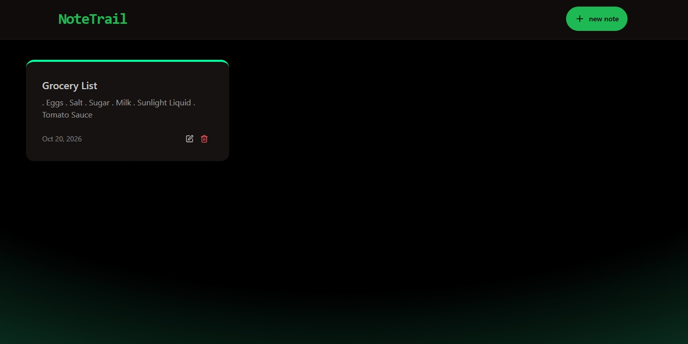
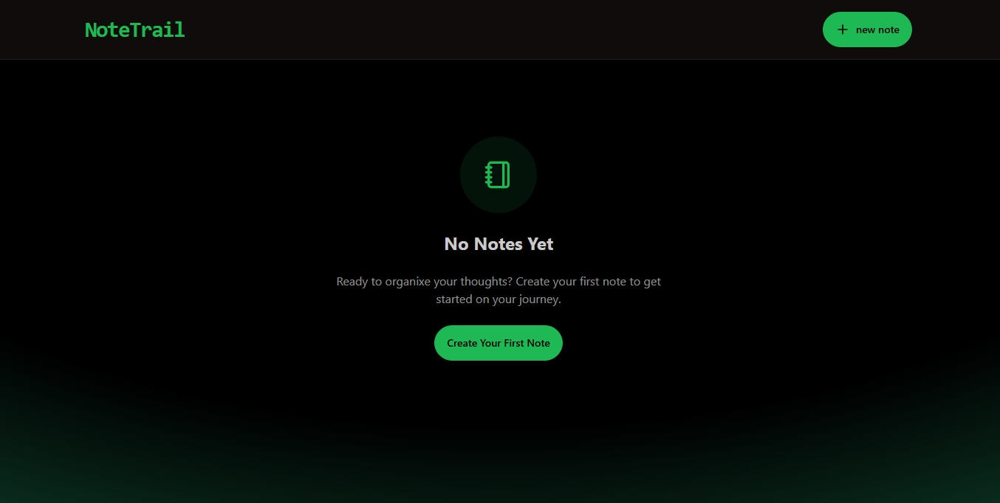
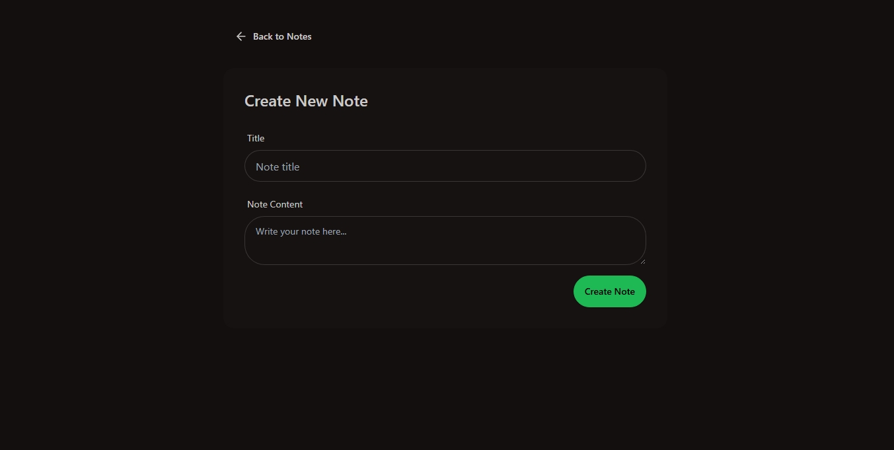
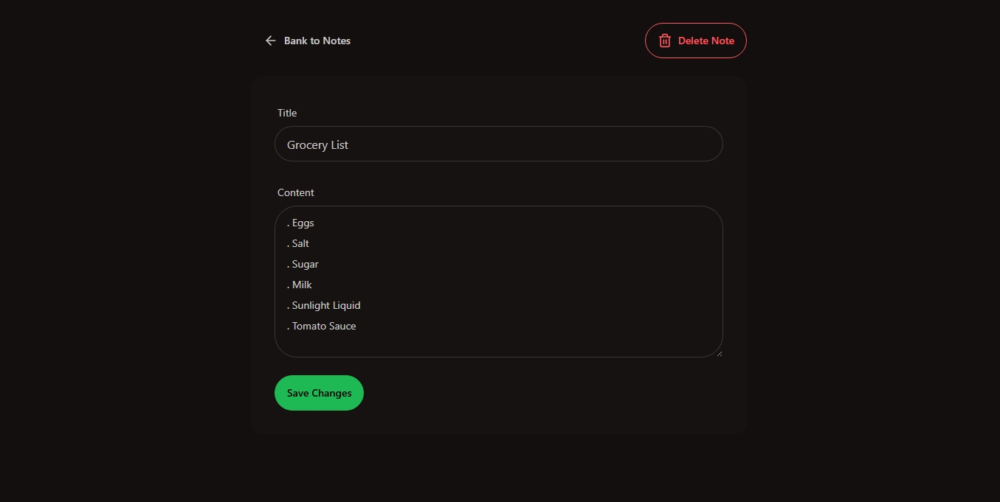

# NoteTrail

A full-stack note-taking app built with the MERN stack. Create, view, edit, and delete notes through a clean dark-themed interface, backed by a REST API, MongoDB, and Upstash Redis rate limiting.

## Live Demo

**[https://notetrail.onrender.com](https://notetrail.onrender.com/)**

> Hosted on Render. If the app hasn't been used for a while, the first load may take a short time while the server wakes up.

## Screenshots

### Home


### Empty State


### Create a Note


### Edit a Note


## Features

- Create, read, update, and delete notes (full CRUD)
- Notes sorted newest first, with automatic created/updated timestamps
- Note detail page for viewing and editing a single note
- API rate limiting (100 requests per 60 seconds) with a dedicated "rate limited" UI
- Toast notifications for success and error feedback
- Empty-state screen when there are no notes
- Single-deployment setup: in production, Express serves the built React app

## Tech Stack

**Frontend**
- React 19 with Vite
- React Router 7
- Tailwind CSS + DaisyUI
- Axios, React Hot Toast, Lucide React

**Backend**
- Node.js + Express
- MongoDB with Mongoose
- Upstash Redis + `@upstash/ratelimit`
- dotenv, CORS

## Project Structure

```
NoteTrail/
├── backend/
│   └── src/
│       ├── config/          # MongoDB (db.js) and Upstash (upstash.js) setup
│       ├── controller/      # Notes request handlers
│       ├── middleware/      # Rate limiter
│       ├── model/           # Mongoose Note schema
│       ├── routes/          # /api/notes routes
│       └── server.js        # Express entry point
├── frontend/
│   └── src/
│       ├── components/      # Navbar, NoteCard, NotesNotFound, RateLimitedUI
│       ├── Pages/           # HomePage, CreatePage, NoteDetailPage
│       ├── lib/             # Axios instance and helpers
│       ├── App.jsx
│       └── main.jsx
└── package.json             # Root build/start scripts
```

## Prerequisites

- [Node.js](https://nodejs.org/) v18 or later
- A [MongoDB](https://www.mongodb.com/) database (local or Atlas)
- A free [Upstash Redis](https://upstash.com/) database for rate limiting

## Getting Started

### 1. Clone the repository

```bash
git clone https://github.com/Frans-Motshele/NoteTrail.git
cd NoteTrail
```

### 2. Configure environment variables

Create a `.env` file inside the `backend/` folder:

```env
Port=5001
Mongo_url=your_mongodb_connection_string
UPSTASH_REDIS_REST_URL=your_upstash_redis_rest_url
UPSTASH_REDIS_REST_TOKEN=your_upstash_redis_rest_token
```

| Variable | Description |
| --- | --- |
| `Port` | Port the Express server listens on (the frontend dev setup expects `5001`) |
| `Mongo_url` | MongoDB connection string |
| `UPSTASH_REDIS_REST_URL` | Upstash Redis REST URL |
| `UPSTASH_REDIS_REST_TOKEN` | Upstash Redis REST token |
| `NODE_ENV` | Set to `production` when deploying (enables static serving of the frontend) |

### 3. Run in development

Start the backend:

```bash
cd backend
npm install
npm run dev
```

In a second terminal, start the frontend:

```bash
cd frontend
npm install
npm run dev
```

- Frontend: http://localhost:5173
- Backend API: http://localhost:5001/api

In development, CORS is enabled for `http://localhost:5173`, and the frontend talks to `http://localhost:5001/api`.

### 4. Build and run for production

From the project root:

```bash
npm run build   # installs dependencies and builds the frontend
npm start       # starts the backend, which serves frontend/dist
```

Make sure `NODE_ENV=production` is set in your hosting environment. The Express server then serves the React build and handles API requests from the same domain.

## API Reference

Base URL: `/api/notes`

| Method | Endpoint | Description |
| --- | --- | --- |
| `GET` | `/api/notes` | Get all notes (newest first) |
| `GET` | `/api/notes/:id` | Get a single note |
| `POST` | `/api/notes` | Create a note |
| `PUT` | `/api/notes/:id` | Update a note |
| `DELETE` | `/api/notes/:id` | Delete a note |

### Note model

```json
{
  "_id": "string",
  "title": "string (required)",
  "content": "string (required)",
  "createdAt": "date",
  "updatedAt": "date"
}
```

### Example: create a note

```bash
curl -X POST http://localhost:5001/api/notes \
  -H "Content-Type: application/json" \
  -d '{"title": "Groceries", "content": "Milk, eggs, bread"}'
```

### Rate limiting

Requests are limited to 100 per 60 seconds using a sliding window. Exceeding the limit returns `429 Too Many Requests`, and the frontend shows a rate-limit notice.

## Scripts

**Root**

| Script | Description |
| --- | --- |
| `npm run build` | Install backend and frontend dependencies, then build the frontend |
| `npm start` | Start the backend server |

**Backend** (`/backend`)

| Script | Description |
| --- | --- |
| `npm run dev` | Start with nodemon (auto-reload) |
| `npm start` | Start with Node |

**Frontend** (`/frontend`)

| Script | Description |
| --- | --- |
| `npm run dev` | Start the Vite dev server |
| `npm run build` | Create a production build |
| `npm run lint` | Run ESLint |
| `npm run preview` | Preview the production build |

## Contributing

Contributions, issues, and feature requests are welcome. Feel free to open an issue or submit a pull request.

## License

This project is licensed under the ISC License.

## Author

**Frans Motshele** - [GitHub](https://github.com/Frans-Motshele)
